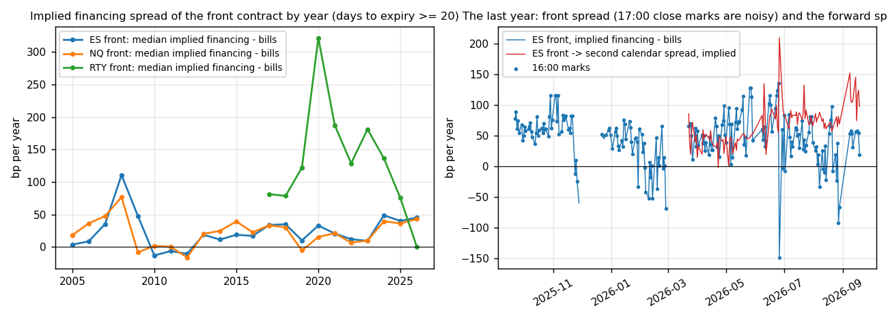
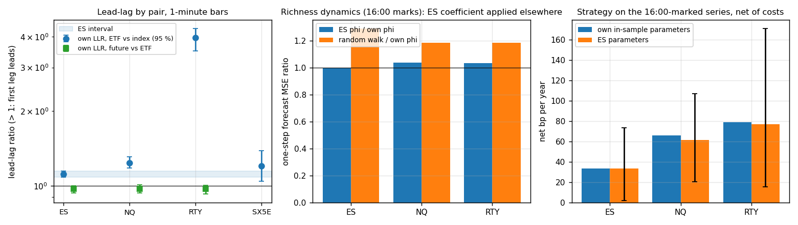

# delta-one-basis

ETF, index future and cash basket for the S&P 500, Nasdaq-100 and Russell 2000, in a Python package (`d1basis`): a fair value with measured financing and dividends, Hayashi–Yoshida lead-lag on one-minute bars, a basis strategy, and a test of what carries from ES/SPY to the other pairs. All data is free and checked in.

The question: where does the basis sit against a fair value with measured financing and dividends, how fast does a deviation close, who leads whom, and does everything fitted on ES/SPY carry unchanged to NQ/QQQ, RTY/IWM and a European pair?

## Results

- **Financing.** With both legs marked at the 16:00 cash close (505 days, 2024-04-29–2026-09-18), the ES front contract implies financing of bills + 50 bp (NQ bills + 42, RTY bills + 71). The dividend accrual inside the quarter is read off the fund's own price: the SPY premium to fair has sd 16.8 bp over 2005–2026, against 23.9 bp with no accrual model.
- **Mean reversion.** Richness to fair has an OLS half-life of 1.2 days on ES. Within the day the minute richness reverts with a half-life of 1.4 min [0.9, 2.3].
- **Lead-lag.** At one-minute resolution the future and the ETF are simultaneous. The ETF leads the cash index by about 30 s (the grid's first step) with LLR 1.12 on SPY/SPX and 3.96 on IWM/RUT: the index lags more where it holds more small names.
- **Strategy.** A z-score rule on the implied financing spread, fitted on ES, nets 34 bp a year of notional on ES [2, 74] and, unchanged, 62 bp on NQ and 77 bp on RTY. The same rule on 17:00-marked futures closes "earns" more with a Sharpe above 2, which is an artefact of marking the legs an hour apart.
- **Transfer.** The accrual model, the mean-reversion dynamics and the strategy parameters carry, with wide intervals. The lead-lag carries in direction, not in size.

| ES | NQ | RTY |
|---|---|---|
| bills + 50 bp, strategy 34 bp/yr | bills + 42 bp, strategy 62 bp/yr | bills + 71 bp, strategy 77 bp/yr |




All numbers are in `results/summary.md`; the detail is in [docs/method.md](docs/method.md).

## How it works

- **Data.** Yahoo daily bars since 2005, one-minute bars archived daily, NY Fed rates, the Treasury curve, SPY holdings and a FirstRateData one-year sample. Futures and ETF dividends come from the funds' own distributions.
- **Fair value.** F* = I(1 + rτ) − D, with the dividend accrued along a profile read off the fund's price against the index.
- **Mean reversion.** AR(1) half-life by OLS and by a noise-robust autocovariance ratio, with a block bootstrap.
- **Lead-lag.** Hayashi–Yoshida covariance over a grid of lags, with the Hoffmann–Rosenbaum–Vetter lead-lag ratio and a day bootstrap. The per-day × lag-grid computation also runs in C++ when built (`cpp/hy.cpp`, pybind11: one call per pair of series, a two-pointer sweep per lag). It returns the Python's numbers to the last bit and is 66× faster on the checked-in data: 0.07 s against 4.9 s for the pipeline's 31 pairs of series and 1,134 days (`results/hy_timing.json`).
- **Strategy and transfer.** Long future against short fund when the implied spread is rich, costed on entry, exit and roll. Parameters fitted on ES are run unchanged on the other pairs.

## Limitations

- One-minute bars are the finest free data, so the seconds-scale future-vs-ETF lead is invisible. The MBP-1 loader is ready for depth data, which I have not bought.
- The 16:00-marked series is 505 days long, so the strategy's intervals are wide and its sensitivity to the near-expiry mask is large.
- The baskets are the funds' largest names at fixed weights (IWM: 6.9 % of the fund), not the replication basket.
- The Euro Stoxx pair has no free future, so it shows what a thin leg does to the estimators rather than a like-for-like pair.

## Run

```
pip install -e .[test]
pip install pybind11 && python build_ext.py build_ext --inplace   # optional C++ core; build.ps1 on Windows
python -m pytest                      # 26 tests
python -m d1basis run --fast          # the pipeline on the checked-in data
scripts/run_all.sh --skip-download    # run, figures, summary, README, notebook, tests
```

The README and `docs/method.md` are written by `scripts/readme.py` from `results/run.json` and `results/hy_timing.json` (`scripts/bench_hy.py`). CI builds the C++ core, runs the pipeline on the checked-in data and checks that both render.
